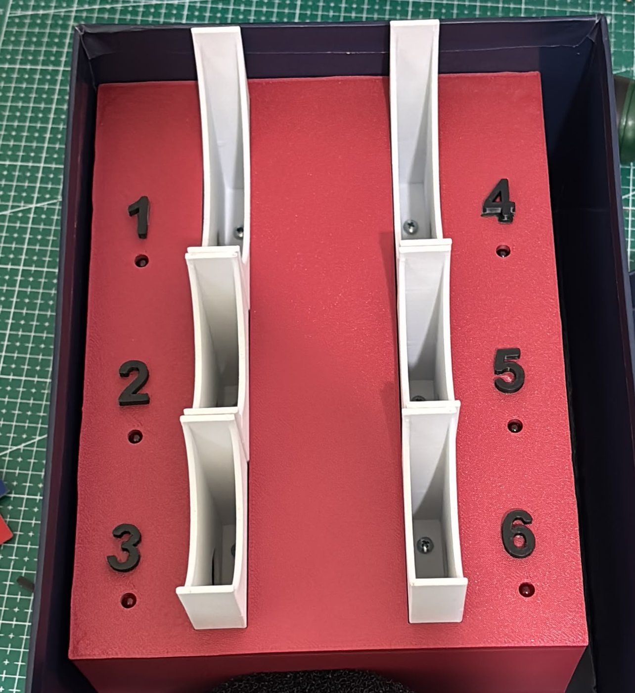
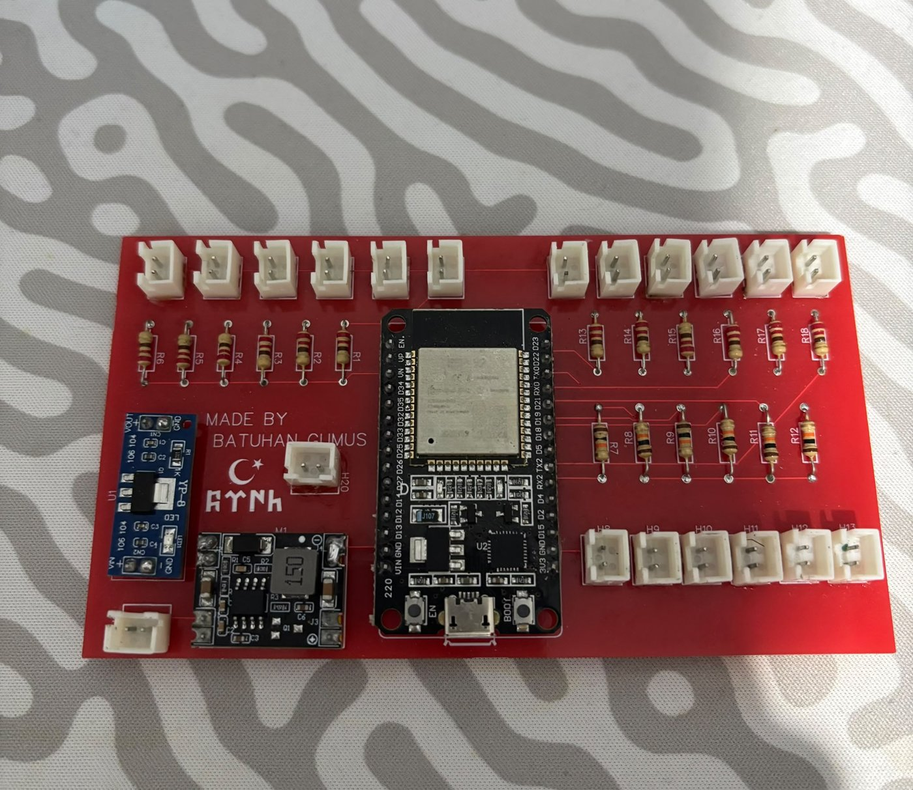
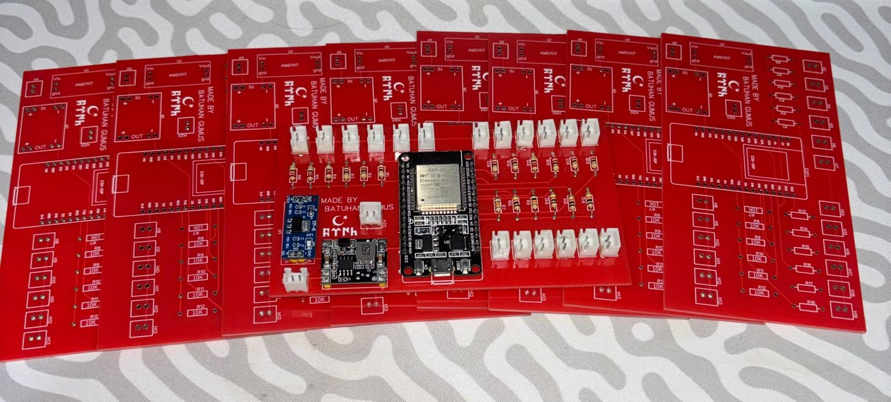
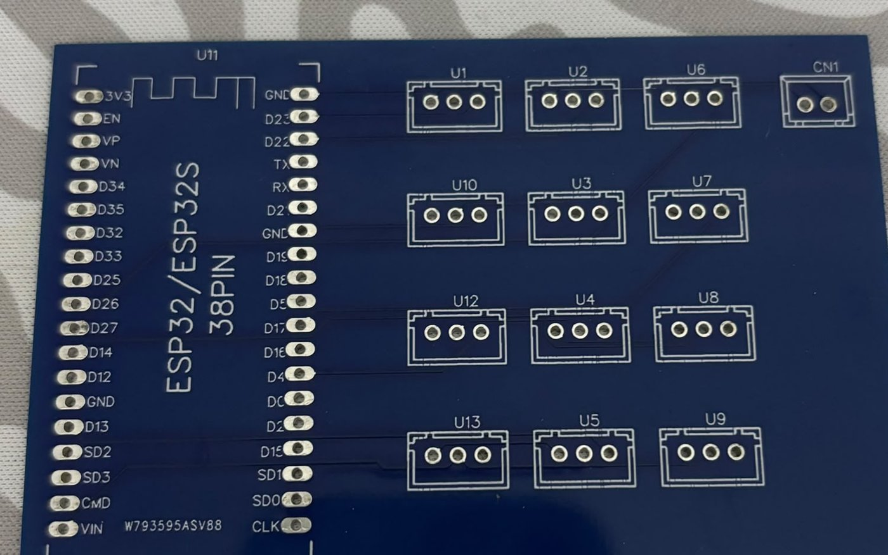
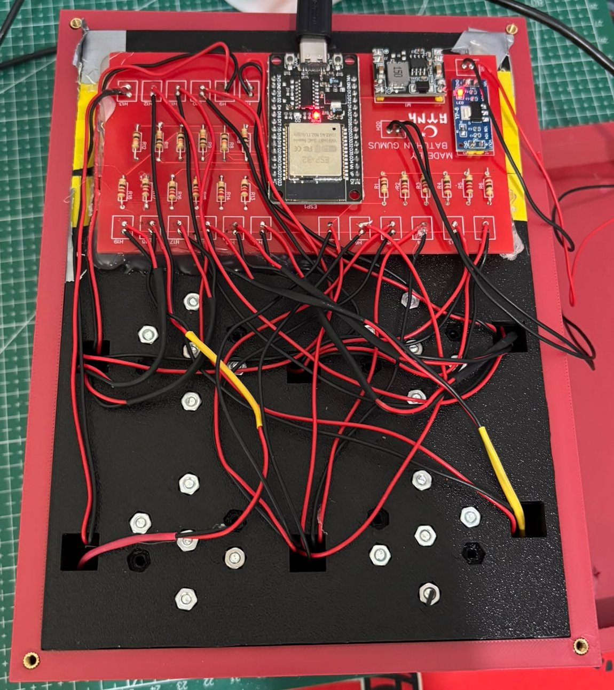
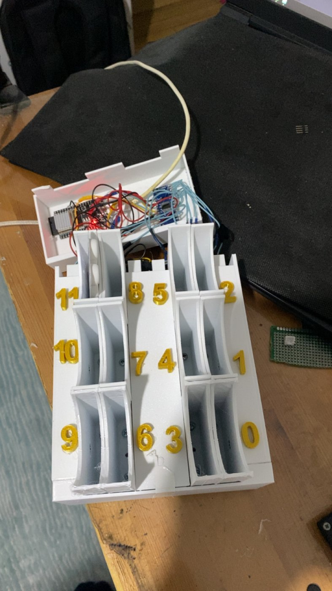
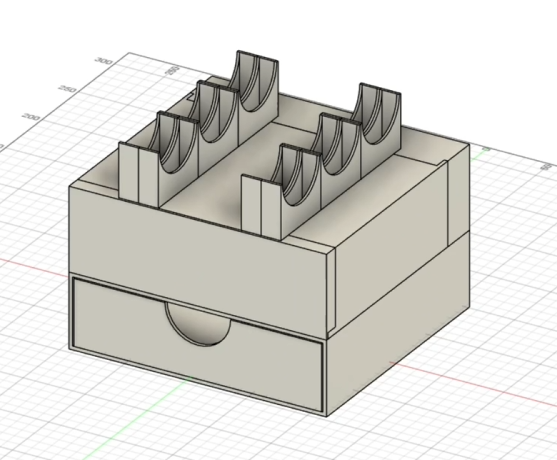

<div align="center">

# SmartPillTracker

**Alınan her dozu otomatik olarak kaydeden akıllı ilaç kutusu. Buton yok, elle giriş yok.**

ESP32 · Özel PCB · Optik algılama · 3D baskı kutu · Spring Boot backend · Android uygulama



</div>

> **Not:** Bu proje kapalı kaynaklı bir üründür. Bu repo projenin tasarımını, donanımını ve sistem mimarisini tanıtmak için hazırlanmıştır. Kaynak kodlar, PCB üretim dosyaları ve CAD dosyaları paylaşılmamaktadır.

---

## Problem

Düzenli ilaç kullanan kişiler, özellikle yaşlı hastalar ve birden fazla ilaç kullananlar, o günkü dozu alıp almadıklarını çoğu zaman hatırlayamaz. Hatırlatıcı uygulamalar ilacın *ne zaman* alınacağını söyler. Ama dozun alındığını kaydetmek için kullanıcının yine "aldım" butonuna basması gerekir. Unutulan adım da tam olarak budur.

## Çözüm

SmartPillTracker kayıt işini kutunun kendisine yaptırır. Her bölmede çıkarılabilir bir ilaç tutucu ve onun yanında bir optik sensör bulunur. Hap ya da blister bölmeden alındığında sensörün durumu değişir. ESP32 bu olayı Wi-Fi üzerinden sunucuya bildirir, backend de doz geçmişini ve kalan stoğu anında günceller. Kullanıcının tek yapması gereken ilacını almaktır.

## Özellikler

- **Otomatik doz algılama:** Optik sensörler her bölmeden ilaç alındığını algılar. Yanlış tetiklemeler cihaz üzerinde debounce ile filtrelenir.
- **6 çıkarılabilir bölme:** 4 küçük ve 2 büyük tutucu var. Doldurmak ve temizlemek için yerinden çıkarılabilirler.
- **Stok takibi:** Her algılanan dozda kalan ilaç sayısı düşer. Stok azaldığında uyarı verilir.
- **Doz geçmişi ve uyum takibi:** Her olay zaman damgasıyla kaydedilir. İlaç uyum raporları bu geçmişten oluşturulur.
- **Tek dokunuşla geri alma:** Yanlışlıkla algılanan bir doz uygulamadan geri alınabilir.
- **Cihaz bazlı güvenlik:** Her cihaz bir kullanıcı hesabına kayıtlıdır ve kendi API anahtarıyla kimlik doğrular.
- **Mobil uygulama:** Geçmiş, hatırlatmalar ve stok bilgisi tek ekranda. Türkçe ve İngilizce dil desteği, açık ve koyu tema var.

---

## Donanım

### Özel PCB, v2 (güncel sürüm)

<p align="center">
  
</p>

ESP32 geliştirme kartı için **EasyEDA**'da tasarladığım taşıyıcı kart. Üzerinde şunlar var:
- Kart üzerinde **DC-DC buck dönüştürücü** modülü ve **AMS1117 3.3 V regülatör**. Cihaz tek bir harici güç kaynağıyla çalışıyor.
- Sensör hatları için kart üzerinde direnç ağı ve **18 adet iki pinli konnektör**. Sensörler doğrudan karta takılıyor, kutunun içinde tek tek kablo lehimlemeye gerek kalmıyor.
- Serigrafide "Made by Batuhan Gümüş" imzası.

İlk üretim partisi sipariş edilip montajı tarafımdan yapıldı:

<p align="center">
  
</p>

### PCB v1

<p align="center">
  
</p>

İlk revizyon, 38 pinli ESP32 için basit bir taşıyıcı karttı. Hazır TCRT5000 sensör modülleri için 13 adet üç pinli soket içeriyordu. v2'de hacimli modüllerin yerine ayrık sensörler kullanıldı ve güç regülasyonu kartın üzerine alındı.

### Kutu ve algılama

<p align="center">
  
  
</p>

Kutuyu **Fusion 360**'ta tasarlayıp 3D yazıcıda bastım. Tasarımda şunlar var:
- Tutucuların altına oturan bir sensör plakası. PCB de tabanın içine monte ediliyor.
- Üst yüzeyde numaralı bölmeler ve gösterge delikleri.
- Hem tek tek haplara hem blister ambalajlara uyacak şekilde kavisli, çıkarılabilir tutucular.

### Tasarımın gelişimi

| 1. Tek bölmeli konsept doğrulama | 2. 12 bölmeli prototip | 3. 6 bölmeli ürün tasarımı |
|:---:|:---:|:---:|
|  |  |  |
| Algılamayı doğrulamak için tek tutucu ve tek TCRT5000 | 12 bölmeli tam kutu, kablolaması elle yapıldı | Kompakt ve kolay basılabilir bir ürün için 6 bölmeye indirildi, özel PCB eklendi |

---

## Sistem mimarisi

```
┌────────────────────────┐   Wi-Fi / HTTP    ┌────────────────────────────┐        ┌─────────────────┐
│  SmartPillTracker      │  sensör olayları  │  Backend (Spring Boot)     │  REST  │  Mobil uygulama │
│  ESP32 + optik         │ ────────────────▶ │  • cihaz doğrulama (API)   │ ◀────▶ │  (Android)      │
│  sensörler + özel PCB  │                   │  • ilaç ve stok yönetimi   │        └─────────────────┘
└────────────────────────┘                   │  • olay kaydı ve analiz    │
                                             │  PostgreSQL + Flyway       │
                                             └────────────────────────────┘
```

1. ESP32 her bölmenin sensörünü sürekli okur (200–300 ms aralıklarla).
2. Sensörde kararlı bir durum değişikliği olduğunda (hap var → hap alındı, 300 ms debounce), cihaz kimliği doğrulanmış bir olay gönderir:
   ```json
   { "deviceId": "esp32-01", "sensorIndex": 3, "event": "pill_taken" }
   ```
3. Backend cihaz anahtarını doğrular ve olayı kaydeder. O bölmedeki ilacın stoğunu bir azaltır, uyum verilerini günceller.
4. Uygulama bölmelerin anlık durumunu, geçmişi, stoğu ve analizleri gösterir.

### Backend

- Kullanıcı, cihaz, ilaç, sensör olayı ve analiz işlemleri için REST API
- İki ayrı API anahtarı türü: uygulama için kullanıcı anahtarı, donanım için cihaz anahtarı
- Veritabanı şeması: `users`, `devices`, `medications`, `sensor_events`. Şema Flyway migration'larıyla yönetiliyor.
- Swagger / OpenAPI dokümantasyonu
- Linux VPS üzerinde PostgreSQL ile birlikte systemd servisi olarak çalışıyor

---

## Kullanılan teknolojiler

| Katman | Teknolojiler |
|---|---|
| **Gömülü sistem** | ESP32, Arduino framework, TCRT5000 optik sensörler |
| **PCB** | EasyEDA, 2 katmanlı kart, DC-DC buck + AMS1117 LDO |
| **Mekanik** | Fusion 360, FDM 3D baskı |
| **Backend** | Java 21, Spring Boot 3, Spring Security, Spring Data JPA, Flyway, PostgreSQL, OpenAPI |
| **Mobil** | Android uygulama, Google Play'de yayında |
| **Web** | İnteraktif 3D ürün yapılandırıcılı tanıtım sitesi, TR/EN |

---

## Bağlantılar

- **Uygulama:** [Google Play'de SmartPillTracker](https://play.google.com/store/apps/details?id=com.bazuan.pilltracker2026)

## Geliştirici

**Batuhan Gümüş**: [GitHub @bazuann](https://github.com/bazuann)

## Lisans

© 2025–2026 Batuhan Gümüş. Tüm hakları saklıdır. Ayrıntılar için [LICENSE](LICENSE) dosyasına bakın.
