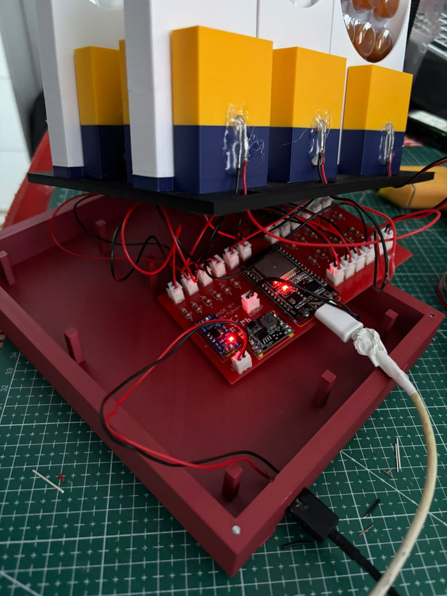
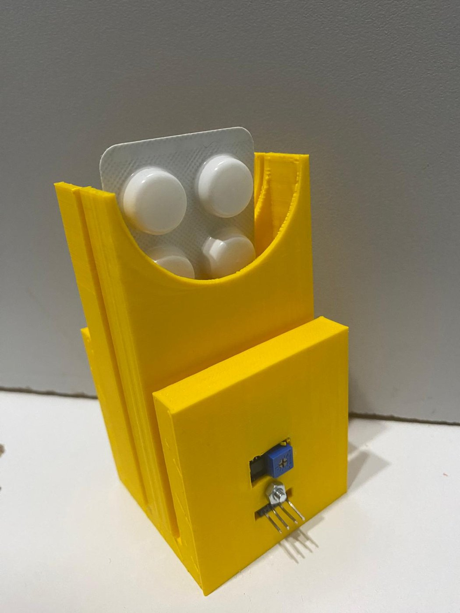

<div align="center">

# 💊 SmartPillTracker

**A smart pill organizer that logs every dose automatically. No buttons, no manual entry.**

ESP32 · Custom PCB · Optical sensing · 3D-printed enclosure · Spring Boot backend · Android app


</div>

> **Note:** This is a closed-source product. The repository is a project showcase: it documents the design, the hardware and the system architecture. Source code, PCB production files and CAD files are not published.

---

## The problem

People on daily medication, especially elderly patients and those taking several prescriptions, often can't remember whether they've already taken a dose. Reminder apps tell them *when* to take it, but they still depend on the user tapping "taken", and that is exactly the step people forget.

## The solution

SmartPillTracker does the logging inside the box itself. Each slot holds a removable pill holder with an optical sensor next to it. When a pill or blister strip is taken out, the sensor state changes. The ESP32 reports the event over Wi-Fi, and the backend updates the dose history and remaining stock right away. The user just takes their medicine.

## Features

- **Automatic dose detection:** optical sensors detect removal from each slot, with debouncing on the device to filter out false triggers
- **6 removable slots:** 4 small and 2 large holders that lift out for refilling and cleaning
- **Stock tracking:** the remaining pill count drops with every detected dose, and a warning appears when stock runs low
- **Dose history and adherence:** every event is timestamped, and adherence reports are built from the history
- **One-tap undo:** accidental detections can be reverted from the app
- **Per-device security:** each device is registered to a user account and authenticates with its own API key
- **Companion app:** history, reminders and stock in English and Turkish, with dark and light mode

---

## Hardware

### Custom PCB, v2 (current)

<p align="center">
  
</p>

I designed it in **EasyEDA** as a carrier board for the ESP32 dev board. It has:
- an on-board **DC-DC buck converter** module and an **AMS1117 3.3 V regulator**, so the device runs from a single external supply
- **18 two-pin connectors** with an on-board resistor network for the sensor lines, so sensors plug in and the box needs no point-to-point soldering
- "Made by Batuhan Gümüş" silkscreen branding

The first batch was ordered and assembled in-house:

<p align="center">
  
</p>

### PCB v1

<p align="center">
  
</p>

The first revision was a simple carrier for a 38-pin ESP32 with 13 three-pin headers for off-the-shelf TCRT5000 sensor modules. v2 replaced the bulky modules with discrete sensors and added on-board power regulation.

### Enclosure and sensing

<p align="center">
  
  
</p>

I designed the enclosure in **Fusion 360** and 3D-printed it. It has:
- a sensor plate that sits under the holders, with the PCB mounted inside the base
- numbered slots with indicator holes on the top face
- removable holders that are curved to fit both loose pills and blister strips

### Design evolution

| 1. Single-slot proof of concept | 2. 12-slot prototype | 3. 6-slot product design |
|:---:|:---:|:---:|
|  |  |  |
| One holder + one TCRT5000 to validate detection | Full 12-compartment box, hand-wired | Reduced to 6 slots for a compact, printable product with custom PCB |

---

## System architecture

```
┌────────────────────────┐   Wi-Fi / HTTP    ┌────────────────────────────┐        ┌─────────────────┐
│  SmartPillTracker      │  sensor events    │  Backend (Spring Boot)     │  REST  │  Mobile app     │
│  ESP32 + optical       │ ────────────────▶ │  • device auth (API key)   │ ◀────▶ │  (Android)      │
│  sensors + custom PCB  │                   │  • medications & stock     │        └─────────────────┘
└────────────────────────┘                   │  • event log & analytics   │
                                             │  PostgreSQL + Flyway       │
                                             └────────────────────────────┘
```

1. The ESP32 reads every slot sensor continuously, every 200–300 ms.
2. When a stable state change happens (pill present → removed, 300 ms debounce), it sends an authenticated event:
   ```json
   { "deviceId": "esp32-01", "sensorIndex": 3, "event": "pill_taken" }
   ```
3. The backend verifies the device key, logs the event, decrements stock for that slot's medication and updates the adherence data.
4. The app shows live slot status, history, stock and analytics.

### Backend

- REST API covering users, devices, medications, sensor events and analytics
- Two separate kinds of API key: user keys for the app and device keys for the hardware
- Database schema: `users`, `devices`, `medications`, `sensor_events`, managed by Flyway migrations
- Swagger / OpenAPI documentation
- Deployed on a Linux VPS as a systemd service, with PostgreSQL

---

## Tech stack

| Layer | Technologies |
|---|---|
| **Embedded** | ESP32, Arduino framework, TCRT5000 optical sensors |
| **PCB** | EasyEDA, 2-layer board, DC-DC buck + AMS1117 LDO |
| **Mechanical** | Fusion 360, FDM 3D printing |
| **Backend** | Java 21, Spring Boot 3, Spring Security, Spring Data JPA, Flyway, PostgreSQL, OpenAPI |
| **Mobile** | Android app, published on Google Play |
| **Web** | Product website with an interactive 3D configurator, EN/TR |

---

## Links

- 📱 **App:** [SmartPillTracker on Google Play](https://play.google.com/store/apps/details?id=com.bazuan.pilltracker2026)

## Author

**Batuhan Gümüş**: [GitHub @bazuann](https://github.com/bazuann)

## License

© 2025–2026 Batuhan Gümüş. All rights reserved. See [LICENSE](LICENSE).
